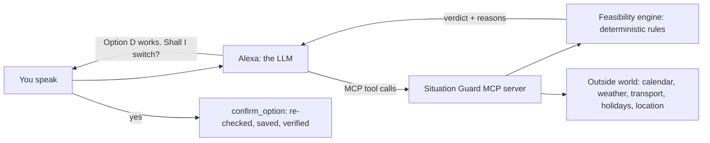

# Situation Guard

**Keep every plan working.** Tell Alexa what you're doing: a meeting, a trip, a show on the shared TV, dinner outside.
When plans clash or reality changes (a delay, rain, a public holiday, a new meeting), Alexa finds fixes, a strict engine
tests every one, and nothing changes until you say yes.

Built for the **Alexa+ track** of the Amazon *Build, Ship, Shape* hackathon as:

- a **self-hosted MCP server** (Streamable HTTP, protocol `2025-11-25`) that Alexa+ or any MCP client can call, and
- a **simulated Alexa+ web app** (voice in, voice out) that talks to that same MCP server.

> Demo video: _add link_

---

## The idea: AI proposes, the engine decides, you approve

Language models are good at understanding "my boss just moved our meeting to 1pm". They are bad at guaranteeing that a
new plan really works. Situation Guard splits the job:



- **Alexa proposes.** She turns what you say into plan edits and picks which alternatives to try.
- **The engine decides.** Only the engine says whether a plan works. Alexa may never claim an option works unless
  `try_option` returned `feasible: true`.
- **You approve.** `confirm_option` is the only tool that changes a plan to a new option. Alexa's agent loop refuses
  to call it unless your last message was a clear yes. The server re-checks the plan before saving, then reloads and
  re-checks it after saving.

It is **generic**: the same engine and tools handle two people and one TV, a day of meetings, an outdoor dinner, an
office closed on a public holiday, or a trip to the airport. Travel is one option source among others.

## What the engine checks

| Rule | Example |
|---|---|
| Dependencies | The flight needs you at the airport first |
| Deadlines | Boarding closes at 17:30 |
| Shared resources | One TV can show one programme at a time |
| One person, one place | You can't be in two meetings at 2pm |
| Nothing in the past | A train that left at 15:01 can't be caught at 15:05 |
| Places can be unavailable | Rain at an outdoor place, an office closed on a public holiday |
| Goals | "Dad boards his 18:00 flight" is at risk if anything it depends on breaks |

When a plan breaks, `find_options` asks option sources for alternatives:

- **Travel** (Amazon Location routes, public transport or car)
- **Reschedule** (move the clashing thing before or after, or move the other one)

`try_option` simulates each alternative on a copy of the plan and returns the engine's verdict.

## MCP tools (17)

| Group | Tools |
|---|---|
| Reading | `list_situations`, `get_situation` |
| Changes | `report_change` (a delay or a cancellation) |
| Options | `find_options`, `try_option`, `confirm_option` |
| Planning | `create_situation`, `add_place`, `add_resource`, `add_commitment`, `add_goal`, `add_dependency` |
| Outside world | `get_weather`, `check_weather`, `check_public_holidays`, `import_calendar`, `add_to_calendar` |

Every tool returns structured results with the engine's verdict and reasons. Tool annotations mark which ones change
state (`confirm_option` is destructive and not idempotent).

## Live data sources

| Source | Used for | Setting |
|---|---|---|
| **Amazon Location Service** (Routes `CalculateRoutes`) | Real public transport and car routes | `SITUATION_GUARD_TRAVEL=live` |
| **Amazon Location Service** (Places `SearchText`) | Turning "Sydney Airport" or an address into coordinates | `SITUATION_GUARD_PLACES=live` |
| **Google Calendar API** | Reading your meetings, adding new ones, moving them after you approve a fix | `SITUATION_GUARD_CALENDAR=google` |
| **Open-Meteo** | Weather now, forecasts, rain at outdoor places, "take an umbrella" | `SITUATION_GUARD_WEATHER=live` |
| **Nager.Date** | Public holidays (e.g. an office closed on Christmas Day) | `SITUATION_GUARD_HOLIDAYS=live` |
| **Browser location** | "From here", weather where you are | asked once in the browser |
| **OpenAI** (`gpt-5-mini`) or **Amazon Bedrock** (Amazon Nova) | Alexa's brain | `SITUATION_GUARD_LLM=openai` or `bedrock` |

Every source also has a free, offline mode (recorded real responses, or known places), so the project runs with no
accounts or keys at all.

---

## Quick start (offline, free, no keys)

Needs **Python 3.11+**.

```bash
git clone https://github.com/fmahin7-ship-it/Alexa-Situation-Guard.git
cd Alexa-Situation-Guard
python -m venv .venv
```

Activate the environment:

- Windows: `.venv\Scripts\activate`
- macOS / Linux: `source .venv/bin/activate`

Then install and run:

```bash
pip install -r requirements.txt
python -m uvicorn app.main:app --port 8000
```

Open **http://localhost:8000** and click the **Train running late** card. It runs on the free scripted brain and
recorded Sydney transport data:

1. "It's 3:05pm on Friday 2 October and my train is running 45 minutes late."
   Alexa reports the plan is broken, finds four real alternatives, and the engine rejects three.
2. "Yes, do it."
   The plan is switched, re-checked and verified.

The right-hand panel shows the plan's timeline and, under **Activity**, every MCP tool call with the engine's verdict.

## Going live

Copy the settings file and edit it. `.env` is gitignored; never commit keys.

```bash
cp .env.example .env
```

| Setting | Values | Notes |
|---|---|---|
| `SITUATION_GUARD_LLM` | `scripted` / `openai` / `bedrock` | `openai` needs `OPENAI_API_KEY` |
| `SITUATION_GUARD_TRAVEL` | `recorded` / `live` | live = Amazon Location Routes (billed per request) |
| `SITUATION_GUARD_PLACES` | `known` / `live` | live = Amazon Location Places (billed per request) |
| `SITUATION_GUARD_WEATHER` | `recorded` / `live` | Open-Meteo, free for non-commercial use |
| `SITUATION_GUARD_HOLIDAYS` | `recorded` / `live` | Nager.Date |
| `SITUATION_GUARD_CALENDAR` | `off` / `google` | see below |
| `SITUATION_GUARD_HOME_ADDRESS` | an address | only needed if you say "home" |
| `SITUATION_GUARD_TIMEZONE` | e.g. `Australia/Sydney` | the current time Alexa is told |

Restart the server after changing `.env`. The sidebar's **Connections** panel shows what is live.

### AWS (Amazon Location)

Use an IAM user or role with only these permissions, in region `ap-southeast-2`, and save it as the AWS profile
`situation-guard` (or set `SITUATION_GUARD_AWS_PROFILE`):

```json
{
  "Version": "2012-10-17",
  "Statement": [
    { "Effect": "Allow", "Action": "geo-routes:CalculateRoutes", "Resource": "arn:aws:geo-routes:ap-southeast-2::provider/default" },
    { "Effect": "Allow", "Action": "geo-places:SearchText", "Resource": "arn:aws:geo-places:ap-southeast-2::provider/default" }
  ]
}
```

For Amazon Bedrock as Alexa's brain, the same profile also needs `bedrock:InvokeModel` for the model in
`SITUATION_GUARD_BEDROCK_MODEL`.

### Google Calendar

1. In Google Cloud, create a project and enable the **Google Calendar API**.
2. Set up the OAuth consent screen (External, testing) and add your Gmail under **Test users**.
3. Create an OAuth client of type **Desktop app**, download the JSON, and save it as `secrets/google_client.json`.
   `secrets/` is gitignored.
4. Set `SITUATION_GUARD_CALENDAR=google` in `.env`.
5. Sign in once. A Google page opens; approve calendar access:

   ```bash
   python -m app.calendars.google login
   ```

The only permission asked for is `calendar.events`. Alexa adds an event only when you ask her to schedule
something and the engine finds no clash, and moves one only after you approve the fix.

## Use it from any MCP client

The MCP server runs at **`http://localhost:8000/mcp`** (Streamable HTTP). Point any MCP client at that URL: the
web app itself reaches the tools exactly this way, not by calling Python directly. The tools and their descriptions
are self-explanatory to an agent; the server also sends short instructions on connect.

## Tests

```bash
python -m pytest -q
```

The tests run offline and free: they pin every source to its recorded mode, and replace AWS, Google and the LLM
with fakes, whatever your `.env` says.

## Project layout

```
app/
  core/         the engine: models, feasibility rules, candidates (edits), simulation
  situations/   saved plans (state/), places, calendar file import
  options/      where alternatives come from: travel (Amazon Location), reschedule
  events/       outside data: weather (Open-Meteo), public holidays (Nager.Date)
  calendars/    Google Calendar: read, add, move; write-back of confirmed changes
  mcp/          the MCP server and its tools
  agent/        Alexa: the prompt, the tool-calling loop, LLM providers, the consent check
  web/          the simulated Alexa+ web app (FastAPI + plain HTML/CSS/JS)
data/           sample plans, recorded real API responses, a sample .ics calendar
tests/          offline tests
docs/           friction log
```

## Safety and privacy

- **Nothing changes without a yes.** Alexa's agent loop blocks `confirm_option` in code unless the user's last
  message is a clear approval ([app/agent/consent.py](app/agent/consent.py)). This is enforced in code, not only
  asked for in the prompt.
- **Alexa never invents facts.** She is told to report a tool's own error, and only an engine verdict counts as
  "this works".
- **Keys stay out of the code.** API keys live in `.env`, Google credentials in `secrets/`, plans in `state/`.
  All three are gitignored.
- **Least privilege.** The AWS policy above allows only route and place search, and Google only gets
  `calendar.events`.

## Going to production

This build is single-user: one Google sign-in, one folder of plans. A public version would add:

- **User accounts** (e.g. Amazon Cognito) or Alexa account linking.
- **Per-user Google sign-in** through the web OAuth flow, with each user's token encrypted per user (DynamoDB + KMS).
- **Per-user plans** in a database.
- **MCP authorization** on the server, so each Alexa+ request acts for the right person.
- **Google app verification**, because calendar access is a sensitive permission.

The engine and the tools don't change.

## Credits

- Weather data by [Open-Meteo.com](https://open-meteo.com/) (CC BY 4.0).
- Public holidays by [Nager.Date](https://date.nager.at/).
- Routes and places by [Amazon Location Service](https://aws.amazon.com/location/).

## License

[MIT](LICENSE)
